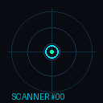
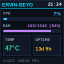

# Ajazz AK820 Pro Linux Screen, Clock & Hardware Controller

[](LICENSE)
[](https://github.com/ErvinUrban-Bratislava/ak820pro-linux/actions/workflows/ci.yml)
[](https://www.python.org/)
[]()
[]()

Native, dependency-light Linux driver and CLI tool for the **Ajazz AK820 Pro** mechanical keyboard (`VID 0x0C45`, `PID 0x800A` / `0x8009`).

Control the `0.85"` 128×128 color TFT screen (live PC hardware HUD, Spotify/browser media player, animated GIFs, milestone countdown radar), synchronize the internal RTC clock from system time, control RGB ambient lighting, and use your keyboard as a visual CI/build status indicator with keypress auto-revert.

See [`FINDINGS.md`](FINDINGS.md) for the complete USB HID protocol and Sonix `SN32F290` ARM Cortex-M0 firmware reverse-engineering notes.

---

<p align="center">
  
  &nbsp;&nbsp;&nbsp;&nbsp;
  
  &nbsp;&nbsp;&nbsp;&nbsp;
  
  &nbsp;&nbsp;&nbsp;&nbsp;
  
</p>

---

## Highlights

- **Live PC Hardware HUD (`ak820 hud`)**: Real-time CPU %, RAM usage, CPU/APU temperature, clock, and system uptime on your keyboard screen.
- **Media "Now Playing" Widget (`ak820 media`)**: Automatically queries `playerctl` or native D-Bus MPRIS to display current track title, artist, and playback status for Spotify, YouTube, VLC, and browsers.
- **CI / Build Indicator with Keypress Auto-Revert (`ak820 run -- make`)**: Pulses breathing amber while your build or tests run, switches to emerald green on pass (or bright red on failure), and **automatically restores your ambient lighting the instant you touch the keyboard to start typing again**.
- **TFT Screen & GIF Engine (`ak820 upload`)**: Upload PNG, JPG, or animated GIFs. Automatically resizes, centers, and converts frames into 128×128 RGB565 little-endian format with SPI flash sector alignment. Repeat uploads skip the ~2 s data-pipe alignment when the previous transfer ended fully-ACKed (state-tracked, fails safe to full alignment).
- **Internal RTC Clock Sync (`ak820 sync-clock`)**: Sets the keyboard's internal clock directly from system time via 64-byte HID feature reports.
- **Milestone Countdown Radar (`ak820 radar`)**: Tracks upcoming birthdays, anniversaries, and personal milestones with high-contrast countdown slides and SHA-256 deduplication.
- **Ambient Lighting Profiles (`ak820 backlight`)**: Curated ambient presets (`warm-white`, `cyber-cyan`, `single-on`), lighting showcase demo, and custom speeds/colors.

---

## Quick Installation

### Option 1: Install Globally via `pipx` (Recommended)
```bash
pipx install git+https://github.com/ErvinUrban-Bratislava/ak820pro-linux.git
```

### Option 2: Clone and Install Locally
```bash
git clone https://github.com/ErvinUrban-Bratislava/ak820pro-linux.git
cd ak820pro-linux
pip install .
```

### Setup `udev` Rules (Non-Root Access)
To allow regular desktop users to access `/dev/hidraw*` without `sudo`:

```bash
sudo cp udev/70-ajazz-ak820pro.rules /etc/udev/rules.d/
sudo udevadm control --reload-rules && sudo udevadm trigger
```

Verify your keyboard is detected:
```bash
ak820 probe
```
Output:
```text
TFT Data Interface (0xFF68):    /dev/hidraw2
Control/RTC Interface (0xFF13): /dev/hidraw3
```

---

## Usage Guide

### 1. Live PC Hardware HUD
Push a real-time system stats card (CPU %, RAM %, CPU temp, uptime, and clock) to the TFT screen:
```bash
# Push current system snapshot
ak820 hud

# Or keep it updating continuously every 15 seconds:
ak820 hud --watch 15
```

### 2. "Now Playing" Media Card
Display currently playing media from Spotify, Chrome, Firefox, VLC, or any MPRIS-compatible player:
```bash
# Push current track info
ak820 media

# Or monitor playback changes continuously:
ak820 media --watch 10
```

### 3. Developer Mode: Wrap Any Shell Command with Keypress Auto-Revert
Turn your keyboard backlight into a physical CI / build status alert:
```bash
# Compiles code: pulses amber while compiling -> green on success / red on failure
# Automatically reverts to your idle profile on your NEXT keypress!
ak820 run --label "Compile" -- make -j16

# Run test suites:
ak820 run --label "Pytest" -- pytest -v
```

### 4. Upload Custom Images & Animated GIFs
Any image or GIF is automatically cropped, fitted, and converted to the native 128×128 RGB565 LE format:
```bash
# Upload bundled Bongo Cat animation
ak820 upload presets/bongo_cat.gif

# Upload any GIF or image with custom fit (fill, contain, stretch)
ak820 upload /path/to/animation.gif --fit fill
ak820 upload /path/to/wallpaper.png --fit contain
```

### 5. Synchronize Internal RTC Clock
```bash
ak820 sync-clock
```

### 6. Milestone Countdown Radar & Custom AI Cards
Track family birthdays, anniversaries, or project milestones:
```bash
# Initialize example config
mkdir -p ~/.config/ak820
cp events.example.json ~/.config/ak820/events.json

# View upcoming milestones
ak820 events list

# Override the config file (accepted before or after the sub-action)
ak820 events list --config ./my-events.json

# Add a milestone (optional --note template; only {years} may be interpolated;
# --short/--title/--note must be single-line — every surface renders one line,
# and a TAB, control character, or bidi format character exits 6: no column can
# stay aligned, and a bidi override reverses the rest of the line's render order)
ak820 events add --title "Daughter's Birthday" --short "DAUGHTER" --date "2025-11-06" --category birthday
ak820 events add --title "Ship V2" --short "SHIPV2" --date "2026-12-01" --note "Shipped {years} yrs after V1"
# Re-adding without --note keeps an existing entry's note; identical re-adds skip the write
# --note is a milestone-entry field: birthdays and anniversaries show fixed text
# ("Turns 37" / "7 Years"), so pairing it with those categories exits 6 instead of
# storing a note that could never render. --clear-note removes a stored note:
ak820 events add --title "Ship V2" --short "SHIPV2" --date "2026-12-01" --clear-note

# Push the 3-Row Family Board (default --view board: 1 frame, 9 chunks, ~2.2 s)
ak820 radar
# Prefer the 2-slide alternating Hero Countdown + Family Board loop (~26.5 s):
ak820 radar --view cycle --sync-clock

# Push custom AI / reminder sticky-note card (--title/--value/--sub/--footer are
# single-line; a line break, TAB/control character, or bidi format character exits
# 6 instead of rendering silently re-shaped, misaligned, or reversed)
ak820 card --title "REMINDER" --value "DEPLOY V1.0" --sub "Production Release" --footer "Ready to ship" --theme warn
```

### 7. RGB Backlight & Ambient Presets
```bash
# Showcase curated presets live on your desk (6 seconds each):
ak820 backlight demo

# Apply and save ambient profile as default idle:
ak820 backlight set --preset cyber-cyan --save
ak820 backlight set --preset warm-white --save

# Manual adjustment:
ak820 backlight set --mode breath --color "#FF8C00" --speed 3 --brightness 4
ak820 backlight off

# Store the idle preset in a different events config (--config is accepted before
# or after the action; `status`/`run` idle-restore honors the same override):
ak820 backlight set --preset cyber-cyan --save --config ./my-events.json
```

---

## Automated Systemd Timers (Optional)

Update your countdown radar and sync the RTC clock every morning at `07:00`:

1. Create `~/.config/systemd/user/ak820-radar.service`:
```ini
[Unit]
Description=Ajazz AK820 Pro Daily Radar & Clock Sync

[Service]
Type=oneshot
ExecStart=%h/.local/bin/ak820 radar --view cycle --sync-clock
```

2. Create `~/.config/systemd/user/ak820-radar.timer`:
```ini
[Unit]
Description=Run Ajazz AK820 Pro Radar daily

[Timer]
OnCalendar=*-*-* 07:00:00
Persistent=true

[Install]
WantedBy=timers.target
```

3. Enable the timer:
```bash
systemctl --user daemon-reload
systemctl --user enable --now ak820-radar.timer
```

---

## Screen Navigation & Troubleshooting

### Switching between the stock screen and your custom screen (`Fn + Del`)

The keyboard has **two independent screens worth of content** and one hardware
shortcut to jump between them:

| Screen | What it shows | How to get it |
|:---|:---|:---|
| **Stock factory time screen** | The firmware's built-in clock/date widget | On power-up, and after every `ak820 sync-clock` |
| **Custom SPI flash screen** | Whatever you last uploaded: custom GIF (`upload`), milestone radar (`radar`), HUD (`hud`), or card (`card`) | Press **`Fn + Del`** on the physical keyboard |

**`Fn + Del` toggles between them.** Uploaded content is written to the keyboard's
SPI flash and stays there across reboots and unplugging — it is never lost, only
de-selected. The one thing that reliably sends the panel back to the stock time
screen is a clock write: **`ak820 sync-clock` (and `radar --sync-clock`) makes the
firmware return to the stock time screen.** Nothing is broken and nothing needs
re-uploading — press **`Fn + Del`** and the custom screen comes straight back.

If `Fn + Del` appears to do nothing, the custom screen is simply empty (nothing
uploaded yet in this SPI flash slot): run `ak820 radar` or `ak820 hud` first.

### Upload speed: single-frame views vs animated GIFs

Screen uploads go over the keyboard's vendor HID pipe in 4096-byte chunks, each
one ACKed by the MCU, so transfer time is proportional to payload size:

| Payload | Frames | Chunks | Bytes | Wall clock |
|:---|:---|:---|:---|:---|
| Single frame — `radar --view board` (default), `--view hero`, `hud`, `media`, `card` | 1 | **9 chunks** | 36 KB | **~2.2 s** |
| Animated GIF / 34-frame `radar --view cycle` | 34 | **273 chunks** | 1.11 MB | **~26.5 s** |

That is why `radar` defaults to `--view board`: the same three countdown rows,
uploaded roughly twelve times faster. Choose `--view cycle` or `upload <gif>`
when you actually want motion, and keep `--view board` for the timer-driven
systemd path (`systemd/ak820-radar.timer`) so a frequent refresh never blocks the
USB pipe for half a minute. Preview any payload's true size without touching USB:

```bash
ak820 --dry-run radar                    # -> 1 frame(s), 9 chunk(s)
ak820 --dry-run radar --view cycle       # -> 34 frame(s), 273 chunk(s)
```

### Screen stuck on `LOADING... xx%`

An upload that dies **mid-stream** — the process was killed, the USB cable
yanked, or a chunk ACK timed out — leaves the panel sitting on its
`LOADING... xx%` dialog, because the firmware only leaves that dialog when it
receives the closing **SAVE** command after a complete transfer.

**Fix: finish a clean transfer.**

```bash
ak820 radar --view board --force
```

This immediately clears the dialog: it streams a complete, small 9-chunk payload
and sends the closing SAVE, so the panel commits the new frame and returns to
normal rendering. `--force` is included because the interrupted attempt may have
left a state record that would otherwise make an identical payload look like a
no-op. If the device itself has gone unresponsive, unplug/replug the cable (the
screen upload requires wired USB) and re-run the same command.

---

## Frequently Asked Questions (FAQ)

### Why does TFT screen upload require a wired USB cable?
The Ajazz AK820 Pro firmware explicitly restricts vendor-specific HID endpoints to wired USB mode. In 2.4 GHz wireless mode (`PID 0x8009`) and Bluetooth mode, the wireless receiver only enumerates standard USB HID keyboard/mouse endpoints (`Usage Page 0x01`), completely omitting vendor Usage Pages `0xFF68` (TFT data pipe) and `0xFF13` (Control pipe).

### How does this compare to OpenRGB?
[OpenRGB](https://openrgb.org/) only controls basic RGB LED matrix patterns and colors. It cannot upload images or GIFs to the TFT display, cannot synchronize the internal RTC clock, does not provide hardware HUD/media widgets, and does not support keypress-aware build status indicators. `ak820pro-linux` provides full control over both the TFT display engine and the keyboard MCU.

### What keyboards are supported?
- **Ajazz AK820 Pro** (`VID 0x0C45`, `PID 0x800A` / `0x8009`) — Fully tested and verified.
- Compatible with other Sonix `SN32F290` based keyboards sharing the same HID report descriptor architecture (e.g. certain AK820 Max variants).

---

## Ops & Observability

Global flags go **before** the subcommand:

```bash
# Verbose diagnostics on stderr; stdout stays machine-readable (JSON parses
# cleanly with stderr discarded):
ak820 --verbose events list --json

# Preview any rendered payload without touching USB (digest + chunk count,
# identical sha256 to what a real upload records — safe in CI / headless):
ak820 --dry-run radar --view hero
ak820 --dry-run upload image.png
```

### systemd Units (`systemd/`)

| Unit | Type | Purpose |
|:---|:---|:---|
| `ak820-radar.service` + `.timer` | oneshot + timer | Refresh the milestone radar every 30 min (dedup makes no-change runs free) |
| `ak820-hud.service` | simple, `Restart=on-failure` | Continuous `hud --watch 15`; a mid-op unplug exits **75** (EX_TEMPFAIL) and systemd re-spawns after re-seating |

```bash
# User units (keyboard access needs the udev GROUP, see Setup above):
mkdir -p ~/.config/systemd/user && cp systemd/ak820-* ~/.config/systemd/user/
systemctl --user daemon-reload && systemctl --user enable --now ak820-radar.timer ak820-hud.service
```

**Out of scope by decision (v0.39.0):** the adaptive policy daemon
`ak820-smartd` (media → HUD → radar screen arbitration) is a personal-
environment integration — its unit and script live in `~/personal-data`
(git-backed there), hard-code one machine's paths, and probe personal
tooling. Vendoring them into `systemd/` would couple this repo to one
machine's layout, so the repo ships only the generic units above.

## Exit Codes

Every `ak820` command follows a stable `$?` contract so scripts and CI wrappers can branch on the exit code without parsing stderr:

| Code | Meaning | Raised as |
|:---|:---|:---|
| `0` | Success (includes dedup skip: identical payload already on screen) | — |
| `2` | Usage error: argparse bad/missing flags, invalid `--mode`/`--color` value, non-finite (nan/inf) or negative `--seconds`/`--watch`/`--dwell`, `backlight` without an action, or `run` with no command | `argparse` / `SystemExit(2)` |
| `3` | Device not found (is the keyboard connected via USB?) | `DeviceNotFoundError` |
| `4` | Permission denied on the device node — install the udev rule from `udev/` (see Setup) | `PermissionDeniedError` |
| `5` | Upload incomplete: device dropped chunk ACKs even after the one automatic full retry — nothing was flashed, no digest recorded | `UploadIncompleteError` |
| `6` | Invalid events config (malformed event date, corrupt JSON, wrong shape — not an object / `events` not a list, `null` included / entry not an object / `backlight` section not an object —, wrong field value type — non-scalar `title`/`date`/`category`/`note`, unsupported `note` placeholder (config value or `events add --note`), non-numeric idle-backlight field, non-boolean `idle_rainbow` such as the string `"false"`, out-of-range idle-backlight field (`idle_mode` outside 0..19, `idle_brightness`/`idle_speed` outside 0..5, `idle_direction` outside 0..3), blank `events add --short`/`--title`/`--note` or `events remove` target (empty or whitespace-only), `events add --note` (or a note a re-add preserves) for `--category birthday`/`anniversary`, which never render a note — use `--clear-note` or `--category milestone` —, a line break, TAB/control character, or bidi format character (U+202E overrides etc.) in `events add --short`/`--title`/`--note` or `card --title`/`--value`/`--sub`/`--footer` (every field renders on a single line: a tab stop depends on the column already reached — no width rule can align one — and a bidi override makes the terminal render the rest of the row reversed — no width rule can fix order), or an unreadable/unwritable config file — nothing saved or rendered) | `ConfigError` |
| `7` | Protocol desync: device answered with a malformed/unexpected reply (ACK magic mismatch), or the data pipe will not align after one retry — transfer state unknown, aborted | `ProtocolError` |
| `8` | Input file not found (`upload <file>` / `--dry-run upload <file>` with a bad path, or `run <missing-command>`) — user error, retrying will not help | `FileMissingError` |
| `9` | Input file exists but is unusable: not an image, a directory, or corrupt/truncated — a `--save-preview` target is an existing directory / non-directory path / not writable (unwritable parent or target, unknown file extension), or `run <command>` is not executable | `InvalidFileError` |
| `10` | No usable display font: no catalog font is installed (or every catalog path is unreadable) — install `fonts-liberation` or `fonts-dejavu-core`. The Pillow built-in default face is refused on purpose (it renders the drawn bullet separator as tofu) rather than silently degrading the screen | `FontMissingError` |
| `75` | `EX_TEMPFAIL`: USB device vanished mid-operation — transient, systemd `Restart=on-failure` will re-run the command | `DeviceDisconnectedError` |
| `130` | Interrupted by user (Ctrl+C / SIGINT) — friendly line, never a traceback; mid-upload nothing was flashed and the digest stays unrecorded, so a re-run re-aligns and retries | `KeyboardInterrupt` |

All driver errors derive from `AK820Error` (`ak820/errors.py`), which carries the exit code as an attribute. A regression test (`tests/test_invariants.py`) fails the build if this table ever drifts from the shipped taxonomy.

## Architecture

Since v0.9.0 the implementation lives in the `ak820/` package (every module < 300 lines); the top-level `ak820_ctrl.py`, `milestone_radar.py`, and `widgets.py` are pure backward-compatibility re-export shims:

| Module | Responsibility |
|:---|:---|
| `ak820/protocol.py` | Constants, Sonix packet framing, reply parsing (no I/O) |
| `ak820/transport.py` | The only fd/IO module: `HidTransport` seam, `AK820ProDevice`, keypress wait |
| `ak820/discovery.py` | sysfs scanning: which hidraw nodes belong to the keyboard (no fd/io) |
| `ak820/device.py` | fd-free device logic (`AK820Pro`, `stream_payload`, bounded timeouts) |
| `ak820/screen.py` | RGB565 packer (optional numpy fast path), image/GIF fitting, cached fonts |
| `ak820/state.py` | Payload-hash dedup + pipe-clean flag driving the §3.5 alignment-skip (`AK820_STATE_PATH` override for tests) |
| `ak820/errors.py` | Error taxonomy + exit-code contract above |
| `ak820/events.py` | Events-config domain: path resolution, date validation, shape checks, countdown rows (PIL-free) |
| `ak820/dates.py` | Locale-independent calendar text: the fixed C-locale month table behind every drawn date label (PIL-free leaf) |
| `ak820/textwidth.py` | Terminal display width at the print seam: cluster-aware column padding for `events list` / `backlight list` — CJK counts 2 cells, ZWJ emoji sequences count as one glyph (stdlib leaf) |
| `ak820/configvalues.py` | Field-value coercion at the `load_events_config` choke point (m18/m21) |
| `ak820/parser.py` | The argparse surface: what the CLI accepts, nothing else |
| `ak820/cli.py` | Offline-first routing, `--dry-run`, discovery, exit-code `main()` |
| `ak820/handlers.py` | Device-bound `(args, dev)` handlers + `DEVICE_HANDLERS` dispatch table |
| `ak820/actions.py` | Upload pipeline: dedup, align-skip, retry policy, clock sync |
| `ak820/backlight.py` / `status.py` / `presets.py` | Lighting: mode byte assembly, workflow status, showcase preset catalog (pure data) |
| `ak820/config.py` | Device-free commands: `events` CRUD + `--save-preview` renders |
| `ak820/renderers.py` | Per-command render helpers shared by live upload and `--dry-run` |
| `ak820/cards.py` / `palette.py` | Radar hero/board/custom 128×128 renderers + urgency palette |
| `ak820/hud.py` / `telemetry.py` | HUD + media card renderers + PIL-free sysfs/proc/MPRIS probes |

For deep-dive reverse-engineering details, including:
- Sonix `SN32F290` ARM Cortex-M0 MCU disassembly and memory maps
- 3-chunk two-stage sub-packet alignment protocol (`align_data_pipe`)
- Firmware 2.0-second chunk watchdog (`[0x200000F0]`) and unbuffered 4096-byte RAM buffer race condition (`0x2000030C`)
- SPI flash animation layout (`0x540000`) and RGB565 little-endian pixel framing

See [`FINDINGS.md`](FINDINGS.md).

---

## Testing

The full suite (600+ tests) is device-free: a `FakeTransport` SN32F290 firmware simulator with injectable ACK drops exercises the upload protocol with no keyboard attached.

```bash
python3 -m unittest discover -s tests -v
```

GitHub Actions runs `py_compile` over every shipped module plus the full unittest suite on **Python 3.10, 3.11, 3.12, and 3.13** (`.github/workflows/ci.yml`). `tests/test_invariants.py` additionally locks the cross-cutting contracts: module compile gate, exit-code taxonomy ↔ `main()` mapping, README ↔ `errors.py` sync, and pipx entry points.

---

## License

MIT License. See [LICENSE](LICENSE) for details.
