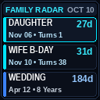

# Ajazz AK820 Pro Linux Screen, Clock & Milestone Radar Controller

[](LICENSE)
[](https://www.python.org/)
[]()

Native Linux CLI tool to control the `0.85"` 128×128 TFT screen (Family Milestone Radar, AI status cards, custom static images, animated GIFs), control RGB backlighting presets, and synchronize the internal RTC clock on the **Ajazz AK820 Pro** (`VID 0x0C45`, `PID 0x800A` / `0x8009`).

See [`FINDINGS.md`](FINDINGS.md) for the complete USB HID protocol and Sonix `SN32F290` ARM Cortex-M0 firmware disassembly notes.

---

<p align="center">
  
  &nbsp;&nbsp;&nbsp;&nbsp;
  
  &nbsp;&nbsp;&nbsp;&nbsp;
  
</p>

---

## Features

- **TFT Screen Control**: Upload PNG, JPG, or animated GIFs to the 128×128 color display with automated RGB565 little-endian conversion and SPI flash sector alignment.
- **RTC Clock Synchronization**: Synchronize internal keyboard date & time directly from system clock via 64-byte HID feature reports.
- **Milestone Radar**: Track upcoming birthdays, anniversaries, and personal milestones with high-contrast countdown slides and SHA-256 deduplication.
- **AI-Ready Custom Cards**: Render and push instant status cards or reminders with semantic color themes (`soon`, `warn`, `urgent`, `today`, `calm`, `green`).
- **RGB Backlight Control & Ambient Presets**: Apply curated ambient profiles (`warm-white`, `cyber-cyan`, `single-on`), cycle through interactive lighting demos, or control speeds and modes.
- **Workflow Status & Keypress Auto-Revert**: Visual compilation/task status indicator (pulses amber while running, turns green on success or red on failure, and automatically restores your idle profile on your next keypress).

---

## Installation & Permissions

### 1. Requirements
- Linux kernel with `hidraw` support
- Python 3.10+
- Pillow (`python3-pil` or `pip install pillow`)
- Wired USB connection (2.4 GHz wireless and Bluetooth modes do not expose the vendor HID display endpoints)

### 2. Setup `udev` Rules
To access `/dev/hidraw*` without `sudo`:

```bash
# Clone the repository
git clone https://github.com/ErvinUrban-Bratislava/ak820pro-linux.git
cd ak820pro-linux

# Copy udev rule and reload
sudo cp udev/70-ajazz-ak820pro.rules /etc/udev/rules.d/
sudo udevadm control --reload-rules && sudo udevadm trigger
```

### 3. Verify Connection
```bash
python3 ak820_ctrl.py probe
```
Expected output:
```text
TFT Data Interface (0xFF68):    /dev/hidraw2
Control/RTC Interface (0xFF13): /dev/hidraw3
```

---

## Usage

### 1. Synchronize Internal RTC Clock
```bash
python3 ak820_ctrl.py sync-clock
```

### 2. Upload Any Image or Animated GIF
```bash
# Upload bundled Bongo Cat animation
python3 ak820_ctrl.py upload presets/bongo_cat.gif

# Upload custom GIF, PNG, or JPG (auto-resized to 128x128 RGB565 LE)
python3 ak820_ctrl.py upload /path/to/image.png --fit fill
python3 ak820_ctrl.py upload /path/to/banner.jpg --fit contain
```

### 3. Milestone Radar (`radar` & `events`)
Reads recurring events from `~/.config/ak820/events.json` (or path set via `$AK820_EVENTS_PATH` or `--config`), computes days remaining and milestone years/ages, and pushes a countdown screen:

```bash
# Quickstart: initialize example events config
mkdir -p ~/.config/ak820
cp events.example.json ~/.config/ak820/events.json

# List upcoming family milestones (add --json for AI agents)
python3 ak820_ctrl.py events list

# Add or update a milestone
python3 ak820_ctrl.py events add --title "Daughter's Birthday" --short "DAUGHTER" --date "2025-11-06" --category birthday

# Push the 2-slide alternating Radar (Hero Countdown + 3-Row Family Board, ~5s per slide)
python3 ak820_ctrl.py radar --view cycle

# Push Hybrid mode (2 loops of Bongo Cat + Hero Countdown + 3-Row Family Board)
python3 ak820_ctrl.py radar --view hybrid

# Push static single-frame Hero Card or 3-Row Board
python3 ak820_ctrl.py radar --view hero
python3 ak820_ctrl.py radar --view board
```

### 4. AI-Ready Custom Status / Sticky-Note Card (`card`)
Any script or AI agent can push an instant 1-frame high-contrast card:
```bash
python3 ak820_ctrl.py card --title "REMINDER" --value "BUY GIFT" --sub "Daughter 1st B-Day" --footer "Nov 06 (17d)" --theme warn
```

### 5. Backlight & Ambient Lighting Showcase (`backlight`)
Configure your preferred ambient lighting profile:
```bash
# Showcase curated presets live on your desk (6 seconds each):
python3 ak820_ctrl.py backlight demo

# List all supported modes and presets
python3 ak820_ctrl.py backlight list

# Apply and save your favorite preset as default idle ambient:
python3 ak820_ctrl.py backlight set --preset warm-white --save
python3 ak820_ctrl.py backlight set --preset cyber-cyan --save
python3 ak820_ctrl.py backlight set --preset single-on --save

# Manual customization:
python3 ak820_ctrl.py backlight set --mode breath --color "#FF8C00" --speed 3 --brightness 4
python3 ak820_ctrl.py backlight off
```

### 6. Workflow Status & Notification Indicators (`status` & `run`)
Ambient status indicators with **auto-revert on your next keypress**:
```bash
# Set status directly from any script or automation:
python3 ak820_ctrl.py status in-progress --label "Running Build" # Breathing Amber
python3 ak820_ctrl.py status success     --label "Build Passed"  # Emerald Green (waits for keypress)
python3 ak820_ctrl.py status failed      --label "Build Failed"  # Bright Red (waits for keypress)
python3 ak820_ctrl.py status idle                                # Immediate restore to idle profile

# Or wrap any long-running shell command:
python3 ak820_ctrl.py run --label "Compile" -- make -j16
# (Pulses amber while compiling -> pulses emerald green or red on finish -> reverts when you touch the keyboard!)
```

---

## Automated Daily Sync (`systemd` User Timer)

To automatically update your countdown radar and sync the clock every morning at `07:00`:

Create `~/.config/systemd/user/ak820-radar.service`:
```ini
[Unit]
Description=Ajazz AK820 Pro Radar & Clock Sync

[Service]
Type=oneshot
ExecStart=/usr/bin/python3 /path/to/ak820pro-linux/ak820_ctrl.py radar --view cycle --sync-clock
```

Create `~/.config/systemd/user/ak820-radar.timer`:
```ini
[Unit]
Description=Run Ajazz AK820 Pro Radar daily

[Timer]
OnCalendar=*-*-* 07:00:00
Persistent=true

[Install]
WantedBy=timers.target
```

Enable and start:
```bash
systemctl --user daemon-reload
systemctl --user enable --now ak820-radar.timer
```

---

## Testing

Run the included unit test suite:
```bash
python3 -m unittest discover -s tests -v
```

---

## Hardware Protocol & Disassembly

For technical details on:
- Sonix `SN32F290` ARM Cortex-M0 MCU interrupt handling
- 3-chunk two-stage sub-packet alignment protocol (`align_data_pipe`)
- Firmware watchdog timers and SPI flash erase timing
- USB HID Feature Reports and endpoints

See [`FINDINGS.md`](FINDINGS.md).

---

## License

MIT License. See [LICENSE](LICENSE) for details.
